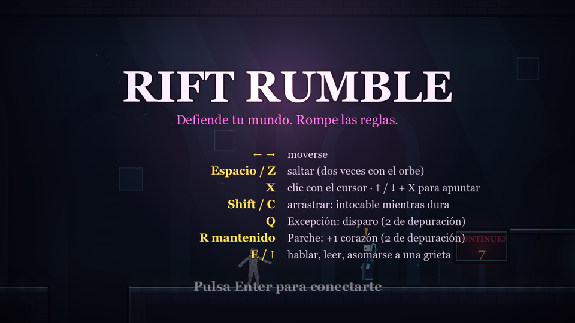
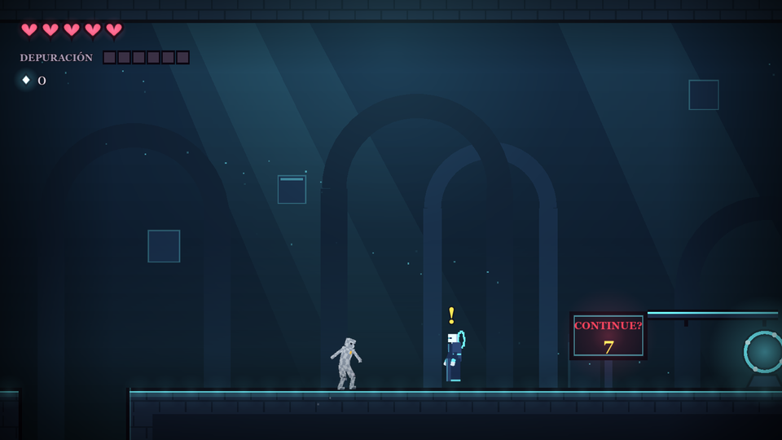
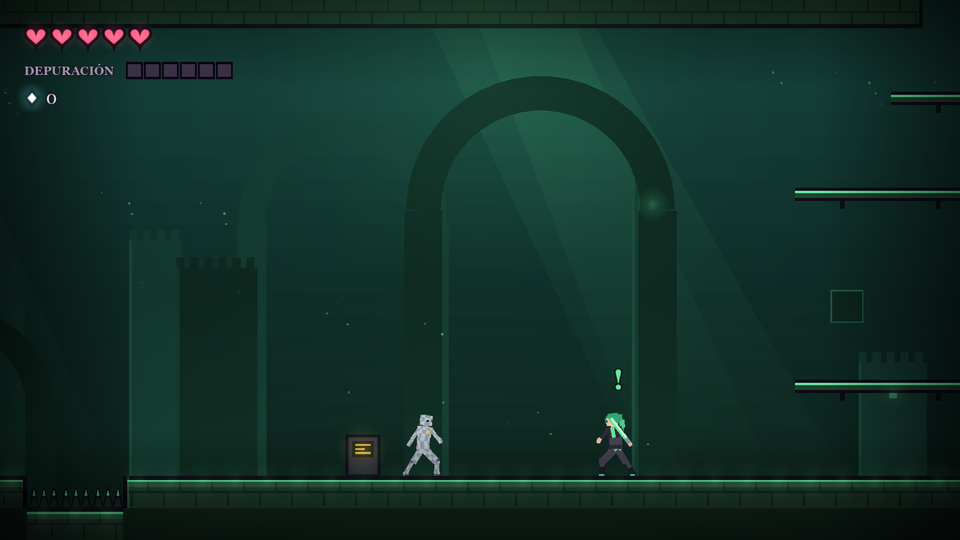
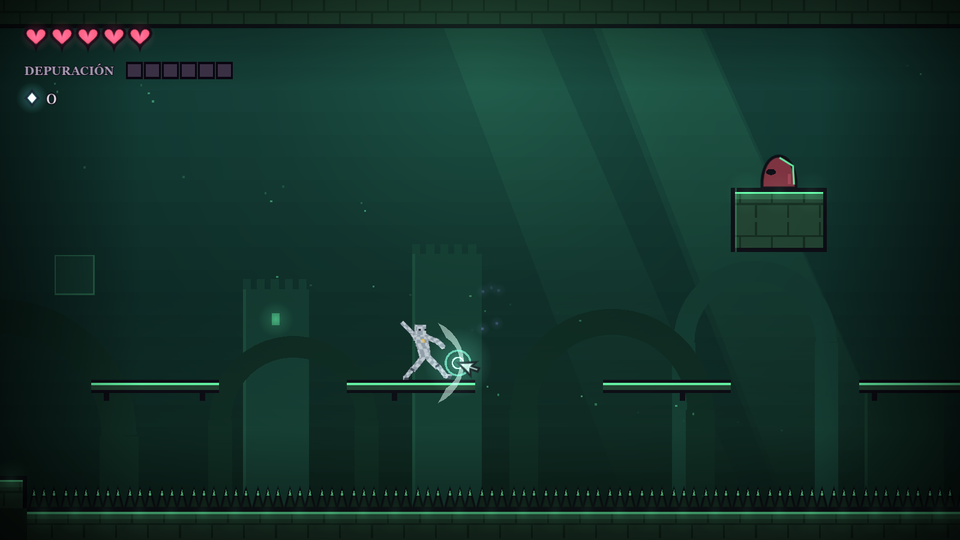
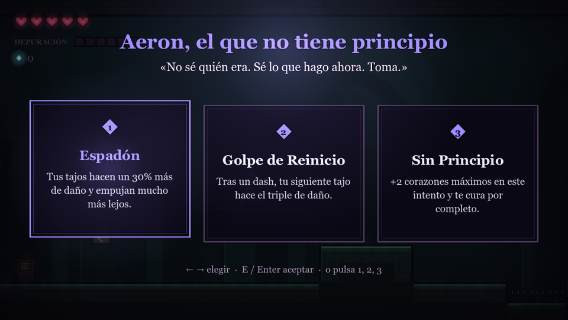
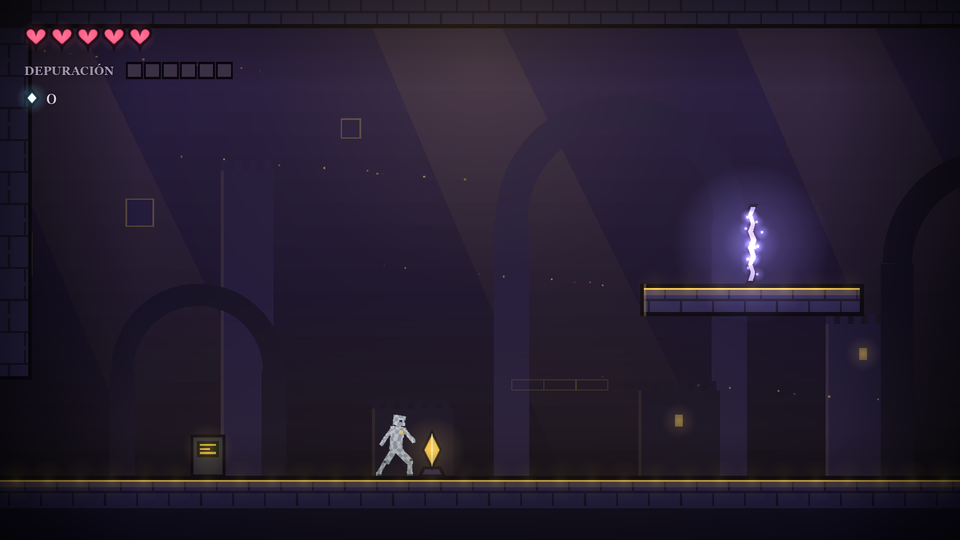
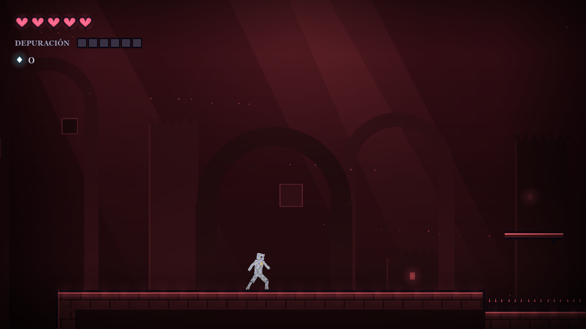
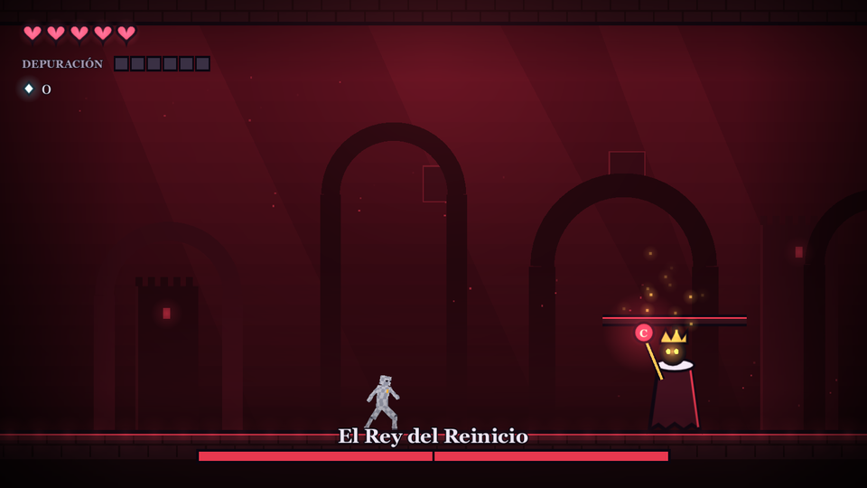
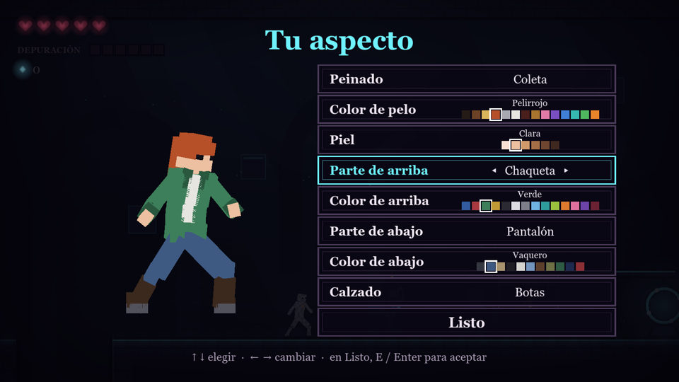
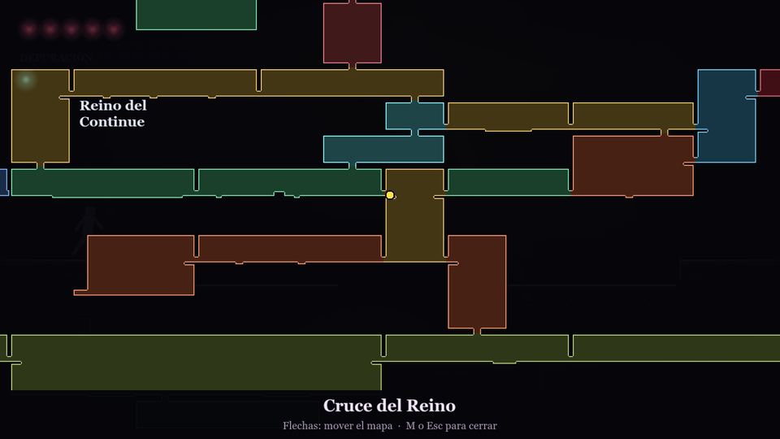

# RIFT RUMBLE

> *Defiende tu mundo. Rompe las reglas.*



Metroidvania 2D lateral con bucle roguelite, para PC, hecho en Godot. **Álex**, un desarrollador, queda atrapado en
su juego de realidad virtual cuando su IA (el **Editor**) fusiona todos sus juegos en uno. La única salida es
terminarlo. Morir dentro no duele: el juego le devuelve al **Umbral de Nexo** y vuelve a intentarlo, conservando lo
que ha aprendido y lo comprado en el anillo.

Argumento completo: [docs/02-argumento.md](docs/02-argumento.md).

## Estado actual (noviembre de 2026)

| Parte | Estado |
|---|---|
| Mundo 1, Reino del Continue | Jugable: 17 salas, el Rey del Reinicio y el orbe de salto doble |
| Mundo 2, Academia del Último Hechizo | Jugable: 11 salas, el Alumno Eterno y el orbe de salto en pared |
| Mundos 3 a 6 | Salas, conexiones y atajos hechos; faltan sus jefes, enemigos propios y habilidades |
| Juego de Kira (final oculto) | Trozos 1 y 2 jugables; los 4 restantes tienen sala pero no nivel |
| Personajes | En 3D en tiempo real sobre el mundo 2D (Álex, Kira y Nexo); Álex se puede personalizar |
| Mapa | Completo, al estilo de Hollow Knight |

Pruebas automáticas: 99 de juego y 429 de alcance, todas correctas.

## Capturas

| | |
|---|---|
|  **El Umbral.** Aquí se vuelve tras cada Continue. Nexo, el guía, y el anillo que mejora a Álex para siempre. |  **Kira.** La protagonista del juego que Álex dejó a medias. Solo aparece al principio y al final. |
|  **Combate.** Álex ataca con el cursor del editor: clics, arrastrar (dash) y Excepción (disparo). |  **Grietas.** Los héroes de otros juegos de Álex le prestan un poder hasta el siguiente Continue. |
|  **Academia del Último Hechizo.** Cristales que, al golpearlos, hacen sólidas las plataformas de cristal. |  **La Última Sesión.** El cine de una game jam, el mundo 3, ya recorrible. |
|  **El Rey del Reinicio.** El jefe del Reino. Vencerle abre el paso a la Academia en ese intento. |  **Tu aspecto.** Tras el primer Continue, Nexo ofrece dejar de ser un maniquí de pruebas. |



**El mapa.** Las salas se dibujan con su forma real y se recorre con las flechas. Mientras se desarrolla enseña todo;
en el juego final solo lo explorado.

## Cómo se juega

- **El bucle.** Cada intento empieza en el Umbral con el mundo como nuevo. Al caer, Álex vuelve allí: pierde los poderes
  de las grietas y lo que llevaba en ese intento, y conserva los fragmentos, las mejoras del anillo, las habilidades y
  los atajos abiertos.
- **El anillo de Nexo.** Con los fragmentos se compran mejoras permanentes: Corazón de Reserva, Clic Afinado,
  Depuración Previa y Continue Extra.
- **Depuración.** Cada golpe que acierta llena la barra. Con ella se lanza la Excepción o se aplica un Parche que cura.
- **Grietas.** Aeron, Zerik, Voltra y Raiko asoman por las grietas y ofrecen tres poderes a elegir uno.
- **Habilidades permanentes.** El salto doble (Torre de las Monedas) y el salto en pared (Pasillo de las Runas)
  abren zonas que antes no se alcanzaban.
- **Atajos.** Algunas puertas solo se abren desde un lado. Una vez abiertas, quedan así para siempre.
- **Arenas y fuentes.** Las arenas cierran sus puertas hasta superar tres oleadas. Las fuentes curan una vez por intento.
- **El juego de Kira.** En cada mundo hay un trozo de su juego tras un muro falso. Terminar los seis desbloquea el final
  oculto.

## Los seis mundos

Los mundos rodean el Umbral y se entrelazan, como en Hollow Knight. Cada jefe abre el mundo siguiente. Plano:
[docs/plano-mundos.png](docs/plano-mundos.png).

| # | Mundo | Qué juego de Álex era | Jefe |
|---|---|---|---|
| 1 | Reino del Continue | Su primer juego publicado, de plataformas | Rey del Reinicio |
| 2 | Academia del Último Hechizo | El proyecto de cuando estudiaba | Alumno Eterno |
| 3 | La Última Sesión | Un juego de terror de una game jam | Proyeccionista (pendiente) |
| 4 | Neón de Medianoche | El juego del gran estudio donde trabajó | Administrador (pendiente) |
| 5 | Vertedero de Ideas | Su carpeta de ideas descartadas | Algoritmo (pendiente) |
| 6 | Frontera Imposible | El juego de realidad virtual que lo provocó todo | El Editor (pendiente) |

Diseño detallado: [Reino del Continue](docs/01-roguelite-reino-del-continue.md) ·
[Reino ampliado](docs/04-reino-ampliado.md) · [Academia](docs/03-mundo-2-academia.md).

## Controles

| Acción | Teclado | Mando |
|---|---|---|
| Moverse | ← → / A D | Stick izquierdo / cruceta |
| Saltar (mantener = más alto; dos veces con el orbe) | Espacio / Z / K | A |
| Clic con el cursor (↑ arriba, ↓ en el aire abajo) | X / J | X |
| Arrastrar: dash, intocable mientras dura | Shift / C / L | RB |
| Salto en pared (con el orbe de la Academia) | empujar hacia la pared en el aire + saltar | |
| Excepción: disparo (2 de depuración) | Q / I | Y |
| Parche: +1 corazón (mantener, 2 de depuración) | R / U | LB |
| Hablar, leer, asomarse a una grieta | E / ↑ | B |
| Mapa (flechas para moverlo) | M / Tab | Back |
| Elegir poder | 1 2 3 / ← → + Enter | |
| Pausa | Esc / P | Start |
| Borrar el progreso (en pausa) | B dos veces | |
| Salir (en pausa) | F10 | |

## Requisitos

- Godot **4.7.x** estable, versión estándar con GDScript (no la .NET).
- Para regenerar los personajes 3D, Blender 5.x y Python con Pillow (ver `tools/personajes/`).

## Comandos

Sustituye `godot` por la ruta de tu ejecutable si no está en el PATH.

Jugar:
```bash
godot --path .
```

Pruebas de juego:
```bash
godot --headless --path . --script res://tests/game_tests.gd
```

Pruebas de alcance (que cada salida, entrada y objeto de cada sala se pueda alcanzar):
```bash
godot --headless --path . --script res://tests/reach_tests.gd
```

Capturas de este README:
```bash
godot --path . --script res://tools/screenshots.gd -- docs/capturas
```

Partida guardada: `user://partida.json` (en Windows, `%APPDATA%\Godot\app_userdata\RIFT RUMBLE\`).

## Estructura

```
src/main.gd, main.tscn  Escena principal: crea el juego y sus vistas, lee controles y avanza a 60 Hz
src/game/               Simulación sin nodos (Game), salas, textos y datos (Data), guardado (SaveData)
src/view/               Dibujo: sala (WorldView), marcador, mapa y menús (UIView), personajes 3D (Avatar3D)
src/core/               Controles de teclado y mando
tests/                  Pruebas headless de la simulación y del alcance de las salas
tools/                  Capturas automáticas y generación de los personajes voxel (Blender)
art/personajes3d/       Modelos 3D de los personajes y sus créditos
docs/                   Diseño, argumento, plano de los mundos y capturas
```

**Cómo se definen las salas.** Cada sala ocupa una o varias pantallas de una cuadrícula (`Data.GRID`). Las
conexiones entre salas vecinas están en `Data.LINKS`, y a partir de ellas se crean solas las puertas, las entradas,
las repisas junto a cada puerta y el mapa. Los créditos de los recursos de terceros están en
[art/personajes3d/CREDITOS.md](art/personajes3d/CREDITOS.md).

## Pendiente

- Jefes, enemigos propios y habilidades de los mundos 3 a 6.
- Los trozos 3 a 6 del juego de Kira y el final oculto.
- Rehacer el esqueleto de los personajes 3D, que hoy es el de una muestra externa.
- Dar más contenido al interior de algunas salas.
